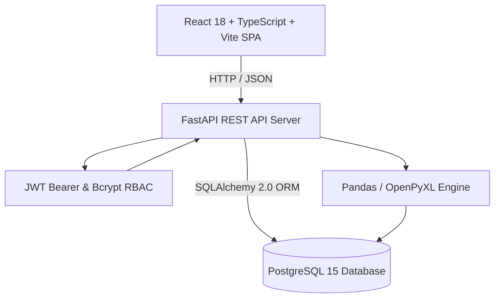

# StockMatrix ERP — Production-Grade Inventory Management Web Application

[](https://fastapi.tiangolo.com)
[](https://reactjs.org)
[](https://www.typescriptlang.org)
[](https://www.postgresql.org)
[](https://tailwindcss.com)
[](https://vitejs.dev)

**StockMatrix ERP (AIM_V0)** is a modern, enterprise-grade inventory management and manufacturing stock tracking web application designed specifically for production and distribution facilities (implemented for **Atlantic Polymers Unit-II** based on audited manufacturing ledger `desktop.xlsx`).

---

## 📑 Table of Contents

- [Key Capabilities & Features](#-key-capabilities--features)
- [System Architecture](#-system-architecture)
- [Project Structure](#-project-structure)
- [Technology Stack](#-technology-stack)
- [Pre-Configured System Users (RBAC)](#-pre-configured-system-users-rbac)
- [Audited Workbook Ingestion & Mathematical Parity](#-audited-workbook-ingestion--mathematical-parity)
- [Installation & Quick Start](#-installation--quick-start)
  - [Prerequisites](#prerequisites)
  - [1. Database Configuration](#1-database-configuration)
  - [2. Backend Setup](#2-backend-setup)
  - [3. Frontend Setup](#3-frontend-setup)
  - [4. Docker Compose (Alternative)](#4-docker-compose-alternative)
- [🌐 Production Deployment Guide (Cloudflare Pages + Render + Supabase)](./DEPLOYMENT.md)
- [REST API Endpoints](#-rest-api-endpoints)
- [Testing & Quality Assurance](#-testing--quality-assurance)
- [License](#-license)

---

## ✨ Key Capabilities & Features

### 1. Real-Time Physical Stock Tracking & Ledger
- **Atomic Transactions:** Inward supply intake, outward order dispatches, and physical stock count adjustments with row-level database locking to eliminate race conditions.
- **Negative Balance Prevention:** Strict database-level checks ensure stock balances cannot drop below zero unless administrative audit overrides are provided.
- **Live Stock Projection Cards:** Real-time balance calculations displayed dynamically as quantities are typed on mutation forms.

### 2. Comprehensive Inventory Analytics & Reports
- **8 Distinct Full-Color Analytical KPIs:**
  - *Total Current Stock* (Blue)
  - *Total Inward Receipts* (Teal)
  - *Total Outward Dispatches* (Purple)
  - *Net Stock Movement* (Indigo)
  - *Low-Stock Products* (Amber)
  - *Out-of-Stock Products* (Rose)
  - *Moving Products* (Emerald)
  - *No-Movement Dormant Products* (Slate)
- **Time-Series Flow Analytics:** Recharts area charts with granular switching (Daily, Weekly, Monthly) and category distribution breakdowns.
- **Configurable Period Comparisons:** Period-over-period percentage delta badges against prior windows.
- **Inventory Health Distribution:** Real-time classification into *Healthy Stock*, *Low Stock Alert*, and *Out of Stock* based on minimum safety stock thresholds.
- **Slow-Moving & Dormant Detection:** Identifies capital tied up in dormant inventory with minimal or zero turnover.
- **Pareto Concentration (80/20 Rule):** Highlights top movement driver SKUs.
- **Mathematical Reconciliation & Parity Audit:** Automated verification checking:
  $$\text{Opening Stock} + \text{Inward} - \text{Outward} + \text{Adjustments} = \text{Closing Stock}$$
- **Multi-Format Export:** Server-side streaming of filtered datasets into styled Excel (`.xlsx`) workbooks and CSV files.

### 3. Role-Based Access Control (RBAC)
- Strict separation of duties enforced through JWT bearer tokens and password hashing via bcrypt:
  - **Administrator:** Full mutation access (Inward, Outward, Adjustments, Workbook Ingestion, User Management).
  - **Viewer:** Read-only analytical access (Dashboard, Product Catalogue, Summary, Movement Ledger, Reports Export).

### 4. Excel Import / Export Engine
- High-performance workbook parsing via Pandas and OpenPyXL with multi-step validation, preview diffs, and batch ingestion.

---

## 🏗️ System Architecture



---

## 📁 Project Structure

```
AIM_V0/
├── backend/
│   ├── alembic/                 # Database schema migrations
│   │   ├── versions/
│   │   └── env.py
│   ├── app/
│   │   ├── api/                 # FastAPI router endpoints
│   │   │   ├── auth.py          # Authentication & user management
│   │   │   ├── inventory.py     # Inward, Outward, Adjustments, Stock Summary
│   │   │   ├── products.py      # SKU catalogue & variant management
│   │   │   ├── analysis.py      # Analytical workspace, KPIs, and reports
│   │   │   └── excel.py         # Excel workbook parsing & import/export
│   │   ├── core/                # Configuration, JWT security, database engine
│   │   ├── models/              # SQLAlchemy 2.0 ORM models
│   │   ├── schemas/             # Pydantic v2 request/response schemas
│   │   └── seeds/               # Initial seed data for users and products
│   ├── tests/                   # Automated pytest suite (18 test cases)
│   ├── requirements.txt         # Python dependencies
│   ├── alembic.ini              # Alembic configuration
│   └── .env.example             # Backend environment template
├── frontend/
│   ├── src/
│   │   ├── api/                 # Axios HTTP client & API bindings
│   │   ├── components/          # Reusable UI components (Header, Sidebar, Select)
│   │   ├── pages/               # Application views
│   │   │   ├── Dashboard.tsx    # Operational metrics & overview charts
│   │   │   ├── Catalogue.tsx    # Product SKU master catalogue
│   │   │   ├── InwardStock.tsx  # Inward intake transaction form
│   │   │   ├── OutwardStock.tsx # Outward dispatch transaction form
│   │   │   ├── StockAdjustment.tsx # Physical balance count adjustment
│   │   │   ├── StockSummary.tsx # Consolidated warehouse balance summary
│   │   │   ├── InventoryAnalysis.tsx # 4-tab analytical workspace
│   │   │   ├── ExcelImportExport.tsx # Excel data upload & export
│   │   │   ├── UserManagement.tsx # User account creation & RBAC
│   │   │   └── Login.tsx        # Authentication screen
│   │   ├── types/               # TypeScript interfaces & types
│   │   ├── index.css            # Tailwind CSS & full-color card utilities
│   │   └── App.tsx              # Router & layout entry point
│   ├── package.json             # NPM dependencies & scripts
│   ├── tailwind.config.js       # Tailwind CSS configuration
│   └── vite.config.ts           # Vite build configuration
├── desktop.xlsx                 # Reference manufacturing source workbook
├── docker-compose.yml           # PostgreSQL Docker service
├── .gitignore                   # Git exclusion rules
├── .env.example                 # Root environment template
└── README.md                    # Project documentation
```

---

## 💻 Technology Stack

### Backend
- **Framework:** FastAPI (Python 3.10+)
- **ORM & Database:** SQLAlchemy 2.0, Alembic, PostgreSQL 15+
- **Data Serialization:** Pydantic v2
- **Data Processing:** Pandas, OpenPyXL
- **Authentication & Security:** Passlib (Bcrypt), PyJWT, OAuth2 Password Bearer
- **Testing:** Pytest, HTTPX

### Frontend
- **Library:** React 18
- **Language:** TypeScript
- **Tooling & Build:** Vite 6
- **Styling:** Tailwind CSS v3
- **Data Visualization:** Recharts
- **Iconography:** Lucide React
- **HTTP Client:** Axios

---

## 🔐 Pre-Configured System Users (RBAC)

| Username | Password | Role | Permissions & Operational Scope |
| :--- | :--- | :--- | :--- |
| **`admin`** | `Admin@123` | `Administrator` | Full operational mutations: Inward, Outward (with database locks), Stock Adjustments, Excel Workbook Ingestion, User Management. |
| **`viewer`** | `Viewer@123` | `Viewer` | Read-only analytics: Product catalogue search, stock summary, KPI metrics, movement history ledger, CSV/XLSX export. All mutations blocked. |

*(Quick-login buttons for both roles are available on the login screen for rapid development evaluation).*

---

## 📊 Audited Workbook Ingestion & Mathematical Parity

The system was audited, verified, and populated directly from manufacturing workbook `desktop.xlsx` (`Stock Summary` sheet):

- **Unique Product SKUs:** `204 items` across 5 primary categories (`WPC Door`, `WPC Frame`, `PVC Sheet`, `MDF`, `Flush Door`).
- **Cumulative Inward Stock:** `10,503 Pcs`
- **Cumulative Outward Stock:** `1,907 Pcs`
- **Physical Closing Stock Balance:** **`8,596 Pcs`** (Exact 100.00% parity with workbook grand total).
- **Audit Anomaly Handling:**
  - Handles legacy negative row 202 (`60X30 D.Brown 7FT`, -5 units) with explicit administrative audit logging.
  - Reconciled category-level header offset (+14 units in legacy spreadsheet header vs item summation) while maintaining verified physical inventory.

---

## 🚀 Installation & Quick Start

### Prerequisites
- **Python:** 3.10 or higher
- **Node.js:** 18.0 or higher
- **PostgreSQL:** 14 or higher (or Docker)
- **Git**

---

### 1. Database Configuration

Create a PostgreSQL database named `inventory_db`:
```sql
CREATE DATABASE inventory_db;
```

Or start PostgreSQL via Docker Compose:
```bash
docker compose up -d db
```

---

### 2. Backend Setup

```bash
# Navigate to backend directory
cd backend

# Create and activate virtual environment
python -m venv .venv

# Windows:
.venv\Scripts\activate
# Linux / macOS:
source .venv/bin/activate

# Install dependencies
pip install -r requirements.txt

# Configure environment variables
cp .env.example .env
# Edit .env with your PostgreSQL credentials if different from default

# Run database migrations
alembic upgrade head

# Seed pre-configured users (admin and viewer)
python -m app.seeds.seed_users

# (Optional) Seed products from desktop.xlsx
python -m app.seeds.seed_from_excel

# Start FastAPI development server
python -m uvicorn app.main:app --host 127.0.0.1 --port 8000 --reload
```

The backend REST API will be available at:
- **API Base:** [http://127.0.0.1:8000/](http://127.0.0.1:8000/)
- **Swagger Documentation:** [http://127.0.0.1:8000/docs](http://127.0.0.1:8000/docs)
- **ReDoc:** [http://127.0.0.1:8000/redoc](http://127.0.0.1:8000/redoc)

---

### 3. Frontend Setup

```bash
# Navigate to frontend directory
cd frontend

# Install NPM dependencies
npm install

# Start Vite development server
npm run dev -- --host 127.0.0.1 --port 5173
```

The frontend application will be accessible at:
- **Web App:** [http://127.0.0.1:5173/](http://127.0.0.1:5173/)

---

### 4. Docker Compose (Alternative)

To spin up the entire application stack (PostgreSQL, Backend API, Frontend SPA) via Docker:
```bash
docker compose up --build
```

---

## 🌐 Production Deployment (Cloudflare Pages + Render + Supabase)

For deploying StockMatrix ERP to free-tier production cloud services:
- **Frontend:** Cloudflare Pages (React + Vite SPA on global edge CDN)
- **Backend:** Render Web Service (FastAPI REST API with automated migrations)
- **Database:** Supabase PostgreSQL (Managed PostgreSQL 15 with connection pooler)

👉 **Read the complete step-by-step deployment guide in [`DEPLOYMENT.md`](./DEPLOYMENT.md).**

---

## 📡 REST API Endpoints

| Category | Method | Endpoint | Description | Auth Required |
| :--- | :--- | :--- | :--- | :--- |
| **Auth** | `POST` | `/api/auth/login` | Authenticate user & issue JWT bearer token | Public |
| **Auth** | `GET` | `/api/auth/me` | Fetch active authenticated user profile | Yes |
| **Users** | `GET` | `/api/users/` | List all system users | Admin |
| **Users** | `POST` | `/api/users/` | Create a new user account | Admin |
| **Products** | `GET` | `/api/products/` | Paginated product catalogue with search | Yes |
| **Products** | `POST` | `/api/products/` | Create product variant SKU | Admin |
| **Products** | `GET` | `/api/products/{id}` | Product variant details & specifications | Yes |
| **Inventory** | `POST` | `/api/inventory/inward` | Record stock inward supply intake | Admin |
| **Inventory** | `POST` | `/api/inventory/outward` | Record stock outward dispatch | Admin |
| **Inventory** | `POST` | `/api/inventory/adjustment`| Reconcile stock balance delta | Admin |
| **Inventory** | `GET` | `/api/inventory/summary` | Consolidated closing stock summary | Yes |
| **Inventory** | `GET` | `/api/inventory/transactions`| Itemized stock ledger entries | Yes |
| **Analysis** | `GET` | `/api/analysis/workspace` | 8 KPIs, time-series, Pareto & reconciliation | Yes |
| **Analysis** | `GET` | `/api/analysis/movement-table`| Filtered SKU movement ledger with pagination | Yes |
| **Analysis** | `GET` | `/api/analysis/export` | Stream analytical report in XLSX or CSV | Yes |
| **Analysis** | `GET` | `/api/analysis/filter-options`| Dynamic filter values (categories, specs) | Yes |
| **Excel** | `POST` | `/api/excel/preview` | Parse workbook & return validation diff | Admin |
| **Excel** | `POST` | `/api/excel/commit` | Persist parsed workbook to database | Admin |
| **Excel** | `GET` | `/api/excel/export` | Export full inventory catalogue as Excel | Yes |

---

## 🧪 Testing & Quality Assurance

### Backend Automated Test Suite
Run the 18 comprehensive integration and unit tests covering authentication, RBAC authorization, stock inward/outward locks, negative balance prevention, and Excel workbook ingestion:

```bash
cd backend
python -m pytest tests -v
```
**Results:** `18 passed, 0 failed (100% pass rate)`.

### Frontend Typecheck & Production Build
Validate TypeScript typings and build the optimized production distribution:

```bash
cd frontend
npm run build
```
**Results:** `✓ built in ~1m, 0 errors`.

---

## 📄 License

This project is licensed under the [MIT License](LICENSE).
